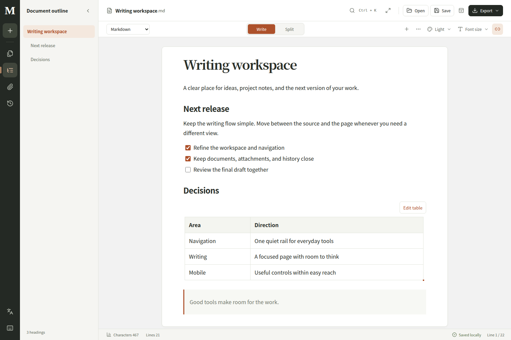
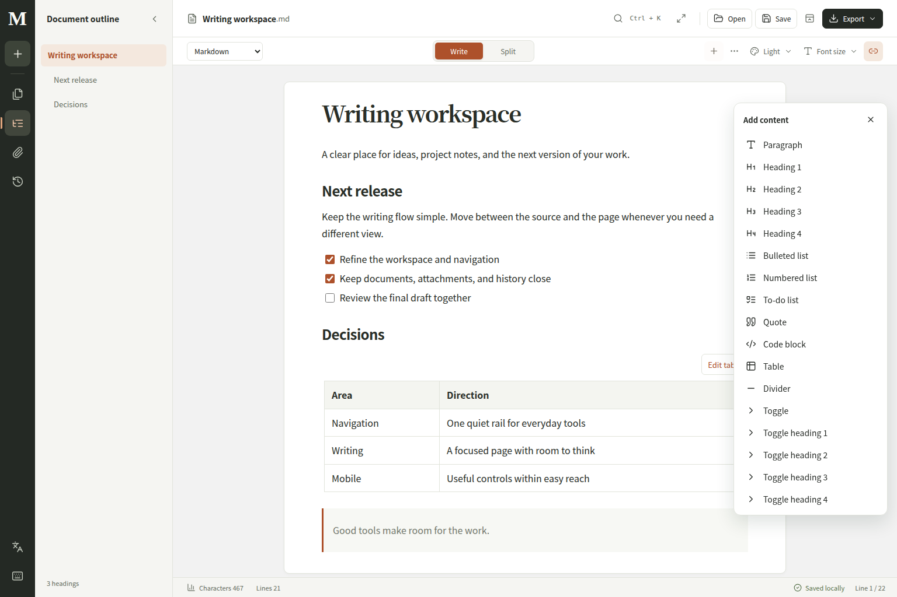
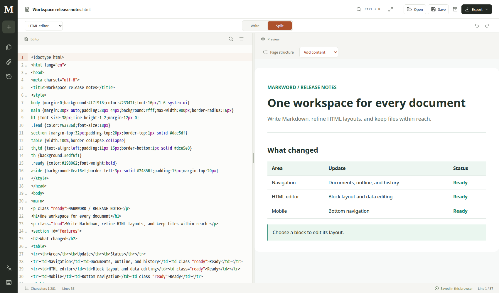

# Markword

**English** | [繁體中文](README.zh-TW.md)

Markword is a browser-based Markdown and HTML editor. Write Markdown directly in an editable preview, add content with a block menu, or keep the source beside your document. HTML documents use the same workspace and document list, with visual layout and embedded-data editing.



## Features

- **Single-page writing**: edit text in place, press Enter to keep writing, and use `/` or **Add content** for headings, lists, quotes, code, tables, and dividers.
- **Source and preview together**: switch to split editing with synchronized scrolling, a document outline, and search. Both views edit the same document and share undo/redo.
- **HTML editing**: edit text, blocks, layout, images, and embedded JSON data while preserving the original page source and styles.
- **Rich content**: editable code blocks with syntax highlighting, task checkboxes, a table editor, Mermaid diagrams, and math.
- **Import and export**: open Markdown, text, Mermaid, HTML, Word (`.docx`), and project ZIP files. Export Markdown, portable HTML, or project ZIP; the full edition also exports PDF and Word.
- **Quick capture and backups**: the local edition shares documents, revision history, and attachments in one database. Press `Ctrl/Cmd+S` to save immediately, or download a project backup.
- **Workspace controls**: a collapsible toolbar, eight preview themes, focus mode, word counts, mobile layouts, and English/Traditional Chinese interfaces.

## Get started

You need Git, Docker, and Docker Compose. This repository is available for viewing and evaluation only; obtain the author's prior written permission before running or deploying it.

```bash
git clone https://github.com/susuky/markword.git
cd markword
docker compose up --build -d
```

Once the build finishes, open [http://localhost:27860](http://localhost:27860). The first start downloads and installs the required packages. Run `docker compose down` to stop the service.

For installation without Docker, see the [local installation and deployment guide](docs/development.md) (Traditional Chinese).

The local service has no sign-in; anyone who can reach port 27860 can read and change its workspace. Restrict network access or use an authenticated reverse proxy before sharing it. See the [security review](docs/security-review-2026-11-12.md).

### Full edition and Pages edition

| Feature | Local full edition | Pages edition |
| --- | --- | --- |
| Single-page / split editing, diagrams, and math | Supported | Supported |
| HTML source, block layout, and data editing | Supported | Supported |
| Documents, revisions, and attachments | Shared local database | Separate browser storage |
| Markdown, portable HTML, and project ZIP | Supported | Supported |
| Direct PDF / Word export | Supported | Unavailable |

In the Pages edition, download portable HTML and use your browser to print it as PDF. Use the local full edition for direct PDF or Word export. See the [deployment guide](docs/development.md#github-pages-建置) for Pages configuration and publishing.

## Writing and editing

### Markdown: single-page or split editing

The left navigation rail opens documents, the outline, attachments, and revision history. **+** creates a document; language and keyboard shortcuts are at the bottom. On mobile, these actions move to the bottom navigation bar. The document sidebar has search, rename, duplicate, and trash controls.

Click **Open**, drop a document into the workspace, or start writing. HTML files open in the HTML editor with their original layout. Word files convert to Markdown; review the result because complex layouts may change.

The preview is editable by default. Choose **Write** for a single page or **Split** to keep the source alongside it. The shared toolbar holds the document format, preview theme, font size, and **Add content** controls. On mobile, use the **Editor** and **Preview** tabs; the arrow keys, Home, and End also switch tabs. The toolbar button beside **Export** collapses or expands these controls and remembers your choice.

[Desktop split view](assets/markword_preview.png) · [Mobile preview](assets/markword-mobile.png)



| To… | In the preview… |
| --- | --- |
| Write or change text | Click a paragraph or heading and type; empty documents are editable too |
| Continue writing | Press `Enter` for a new paragraph or list item; press `Enter` on an empty item to leave the list |
| Insert a block | Type `/` on an empty line or click **+** in the shared toolbar to open **Add content** |
| Insert between blocks | Use the **+** beside a block to insert after it; **Add content** at the bottom continues the document |
| Edit code | Click the code block; type or paste multiple lines, then press `Escape` or `Ctrl/Cmd+Enter` to finish |
| Edit links, tasks, or tables | Select a link to change its address, toggle a checkbox, or choose **Edit table** to change cells, rows, and columns |
| Undo or redo | Open the **…** editing tools menu |

The block menu includes paragraphs, four heading levels, bulleted/numbered/task lists, quotes, code, tables, and dividers. Paste or drop images and attachments into the workspace to add them.

In the Markdown source editor, type `[] ` or `[ ] ` for a checkbox, `> ` for a toggle, or `" ` for a quote. Headings use `# ` through `#### `; lists use `- ` or `1. `. Legacy `[] Task` lines also render as clickable checkboxes. In the visual editor, Enter splits a block at the caret and Shift+Enter adds a line break inside the block.

Edits update the same source and browser draft. Code highlighting returns when you leave a code block. Blocks containing formulas, footnote references, or media still use the source editor. Editing a block in the preview may normalize its Markdown, including list indentation, emphasis markers, or reference links; other blocks keep their original source.

### Edit HTML without writing markup

Open or drop an `.html`/`.htm` file to create an HTML document in the current workspace. Your document list and other documents stay available. To edit HTML already in the source pane, choose **HTML editor** from the document mode menu; switching modes keeps the current content.



1. **Open a page**: choose an `.html`/`.htm` file, or paste a complete page or fragment into the source pane and select HTML mode.
2. **Edit the page**: click text or form fields to edit them. Use the page structure to select, reorder, duplicate, or delete blocks. Block settings control layout, spacing, width, alignment, typography, and images. Changes share the source editor’s undo history.
3. **Save or download**: `Ctrl/Cmd+S` saves the document. Use **Export** to download HTML or a project ZIP.

The downloaded file retains its original styles and scripts. Inline page scripts render charts and tables in an isolated frame. Use **Data** to edit embedded JSON fields and recalculate the page, or **Interactive preview** to operate its controls. External scripts, API calls, and navigation are blocked.

Use **Create static copy** to turn the current rendered page into a separate editable document, including generated text and tables. The copy removes scripts and interactive buttons; the original document remains in the workspace.

Relative-path resources are not imported with the HTML file; use embedded assets or full URLs. Visual edits may normalize markup whitespace and quoting.

Markword portable HTML restores its embedded editable source and document mode. Existing drafts from the former separate HTML page appear in the document list.

## Saving and exporting

In the local workspace, **Save** or `Ctrl/Cmd+S` saves directly to the shared local database. Conflicting edits are saved as a separate copy. The document sidebar stays open when switching, creating, importing, or copying documents. Use **Export → Save as…** to write a file, or download a format below. The Pages edition retains browser file saving and downloads.

| Format | Use it for |
| --- | --- |
| Markdown / text / Mermaid / HTML | Editable source; local attachments are separate |
| Project ZIP | Back up the current document and its referenced local attachments, then reopen them for editing |
| Portable HTML | Share an offline-readable document with its source and referenced local attachments |
| PDF / Word | Print or deliver a document; Word uses a fixed layout |

### Useful shortcuts

| Shortcut | Action |
| --- | --- |
| `Ctrl/Cmd+S` | Save the current document |
| `Ctrl/Cmd+F` | Search and replace in the source editor |
| `Ctrl/Cmd+K` | Open the workspace command palette |

### Drafts and backups

The local edition stores documents, trash, revisions, and attachments in `data/markword.sqlite3`, shared by browsers connected to that Markword service. Existing browser data is imported on first use; different documents with the same ID are kept as separate copies. The Pages edition retains separate browser storage.

For a full local backup, stop the service and copy the `data` directory; Docker uses the `markword-data` volume. To export a single document:

- **Markdown**: export a project ZIP to keep the current document and its referenced local attachments. ZIPs do not include revision history or other documents.
- **HTML**: download the original HTML source or a project ZIP. Reopening the ZIP preserves HTML mode, styles, and scripts.

Editing and format conversion run in the browser. The local edition saves documents, revisions, and attachments to the connected Markword service and its SQLite database. That service also handles PDF/Word export.

## Learn more

See the [development and deployment guide](docs/development.md) (Traditional Chinese) for local development, configuration, API details, and export limits.

## Bug reports and feature suggestions

This project accepts bug reports and feature suggestions through [GitHub Issues](https://github.com/susuky/markword/issues) only. External pull requests are not accepted. See the [reporting guide](CONTRIBUTING.md) (Traditional Chinese) for details.

## Copyright

Third-party dependencies retain their respective licenses.

```less
Copyright © 2026 Hao-Ping Lin (@susuky). All rights reserved.

This repository is publicly accessible for viewing and evaluation only.
No license is granted to use, copy, modify, redistribute, sublicense, or use this software commercially without prior written permission.
```
