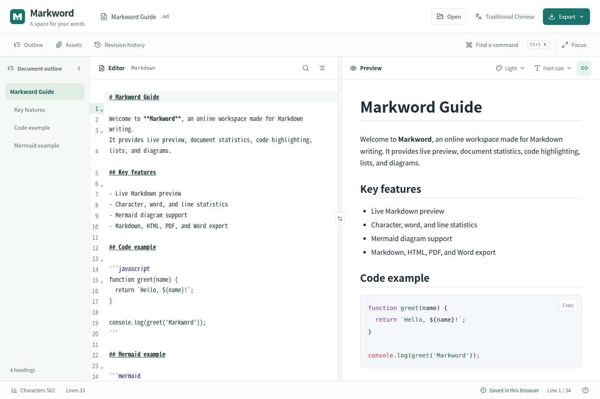
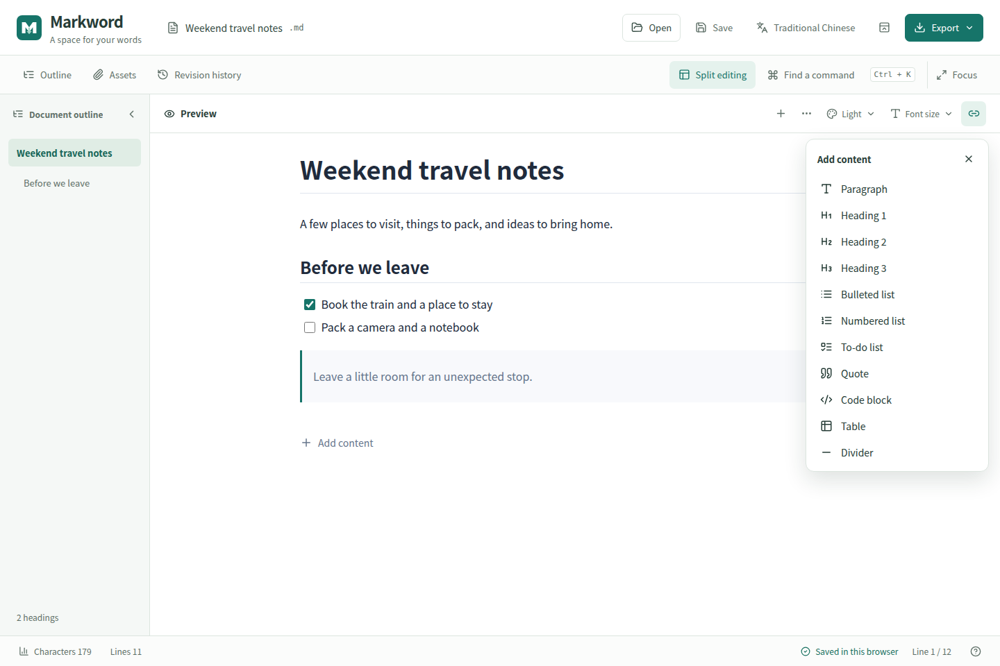
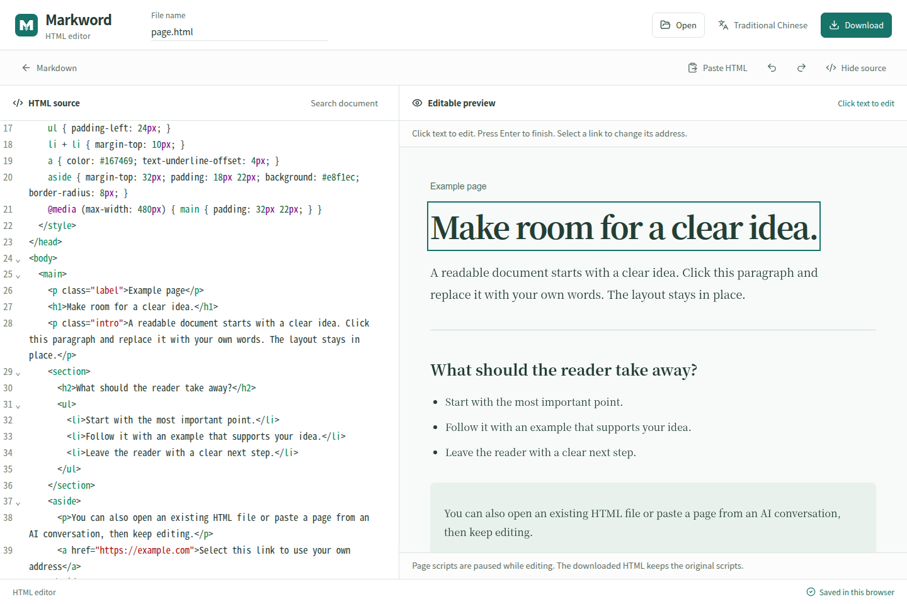

# Markword

**繁體中文** | [English](README.md)

Markword 是在瀏覽器中使用的 Markdown 與 HTML 編輯器。Markdown 可以直接在預覽中寫作、透過區塊選單新增內容，也可以開啟雙欄，同時查看原始碼。獨立的 HTML 編輯頁則能開啟網頁、修改文字與連結，不必先學 HTML 語法。



## 主要功能

- **單頁寫作**：直接修改文字，按 Enter 繼續寫；用 `/` 或「新增內容」插入標題、清單、引用、程式碼、表格與分隔線。
- **區塊編輯**：拖曳排序、多選、複製、刪除與類型轉換；用折疊區塊與子區塊整理長文件。
- **雙欄編輯**：原始碼與預覽同步捲動，搭配文件大綱與搜尋；兩種視圖編輯同一份文件，共用復原與重做記錄。
- **文件工作區**：新建、搜尋、切換、重新命名與建立複本；移到垃圾桶的文件可還原，每份文件有自己的版本記錄。
- **HTML 編輯**：開啟或貼上 HTML，點選文字與連結修改，再下載保留原有樣式的頁面。
- **圖文與程式碼**：可編輯並上色的程式碼區塊、待辦勾選、表格編輯器，以及 Mermaid 圖表與數學公式。
- **匯入與匯出**：開啟 Markdown、純文字、Mermaid、HTML、Word（`.docx`）及專案 ZIP；匯出 Markdown、可攜 HTML 或專案 ZIP，完整版另支援 PDF 與 Word。
- **草稿與備份**：瀏覽器自動保存草稿、Markdown 版本記錄，以及包含引用附件的專案備份。
- **工作區調整**：可收合工具列、八種預覽主題、專注模式、字數統計、手機版面與繁體中文／英文介面。

## 快速開始

需要 Git、Docker 與 Docker Compose。本儲存庫僅供檢視與評估；執行或部署前須取得作者的事先書面許可。

```bash
git clone https://github.com/susuky/markword.git
cd markword
docker compose up --build -d
```

建置完成後，開啟 [http://localhost:27860](http://localhost:27860) 即可使用。第一次啟動會下載並安裝所需套件；停止服務可執行 `docker compose down`。

不使用 Docker 時，請參閱[本機安裝與部署](docs/development.md)。

### 完整版與 Pages 版

| 功能 | 本機完整版 | Pages 版 |
| --- | --- | --- |
| 單頁／雙欄編輯、圖表與公式 | 支援 | 支援 |
| HTML 原始碼與點選編輯 | 支援 | 支援 |
| 瀏覽器草稿、版本記錄與附件 | 支援 | 支援 |
| Markdown、可攜 HTML 與專案 ZIP | 支援 | 支援 |
| 直接匯出 PDF／Word | 支援 | 不提供 |

Pages 版可以先下載可攜 HTML，再透過瀏覽器列印成 PDF；需要直接匯出 PDF 或 Word 時，請使用本機完整版。Pages 的設定與發布方式請參閱[部署文件](docs/development.md#github-pages-建置)。

## 寫作與編輯

### Markdown：單頁或雙欄編輯

點選「開啟」、將文件拖入工作區，或直接開始寫作。在這個工作區開啟 HTML／Word 會轉成 Markdown，複雜版面可能改變，請檢查轉換結果。

上方「文件」可開啟文件清單，搜尋名稱、建立新文件，或從各文件的「⋯」重新命名、建立複本及移到垃圾桶。開啟檔案會新增一份文件，先前的內容仍留在清單中；切換前會保存目前修改，重新載入後會回到上次使用的文件。若保存失敗或其他分頁已修改同一份文件，請先下載備份，再依畫面提示處理。

HTML／Word 匯入後，可從底部「匯入摘要」查看樣式、合併儲存格、圖片及其他轉換提醒。摘要隨瀏覽器草稿與版本保存，重新整理後仍可開啟；開啟其他文件不會沿用舊摘要。目前無法自動標示受影響的位置，請對照原檔檢查。

預覽預設就能編輯。桌面點選「單頁編輯」可隱藏原始碼，點選「雙欄編輯」則重新顯示；手機可切換「編輯／預覽」分頁。「匯出」旁的工具列按鈕可展開或收合工作區工具，並記住上次選擇。



| 想做什麼 | 在預覽中的操作 |
| --- | --- |
| 寫作或修改文字 | 點選段落或標題後輸入；空白文件也能直接開始寫 |
| 繼續往下寫 | 按 `Enter` 新增段落或接續清單；沒有子項的空白清單項目再按 `Enter` 即可退出清單 |
| 插入區塊 | 空白行輸入 `/`，或按預覽上方的「＋」開啟「新增內容」選單 |
| 在內容之間插入 | 桌面滑過區塊後，按左側「＋」可在該區塊後方插入；也可在左側原始碼放好游標，再按預覽上方的「＋」；選取區塊後按操作工具列的「＋」可在選取內容後方插入 |
| 選取多個區塊 | 先點選左側把手，再按住 `Shift` 點選其他區塊的文字或把手；`Ctrl`／`⌘` 點選把手可增減選取；手機先按「繼續選取區塊」，再點選其他把手 |
| 移動區塊 | 拖曳把手，依放置提示調整順序；也可使用「上移區塊／下移區塊」按鈕 |
| 複製或刪除區塊 | 選取區塊後按「複製區塊／刪除選取區塊」；多選可一次處理 |
| 轉換區塊類型 | 選取區塊後，從「轉換為…」選擇類型 |
| 整理子區塊 | 選取區塊後按「縮排為子區塊／移出子區塊」；清單內可按 `Tab` 縮排、`Shift+Tab` 移出 |
| 展開或收合內容 | 新增或轉換成「折疊區塊」，點標題前的箭頭展開或收合；標題與展開後的內文都能直接編輯 |
| 修改程式碼 | 點選程式碼區塊，可輸入或貼上多行內容；按 `Escape` 或 `Ctrl/Cmd+Enter` 完成 |
| 修改連結、待辦或表格 | 選取連結可改網址、待辦可直接勾選；「編輯表格」可修改儲存格、列與欄 |
| 設定文字格式 | 在同一段落、標題或清單項目內選取文字，使用浮動工具列設定粗體、斜體、行內程式碼或連結 |
| 復原或重做 | 開啟預覽上方的「⋯」工具選單 |

區塊選單提供段落、三級標題、項目／編號／待辦清單、引用、程式碼、表格、分隔線與折疊區塊。圖片與附件可貼上或拖入工作區。

含子清單的項目按 `Enter` 後，後半文字與子項會接到新項目，游標停在新項目的文字行，可直接繼續輸入。預覽上方的「＋」依最後編輯的位置插入：原始碼使用游標位置，預覽使用目前區塊；頁尾的「新增內容」則接在文件最後。

桌面把手與旁邊的「＋」在滑鼠移到區塊、鍵盤聚焦或區塊已選取時顯示；手機持續顯示把手，並可從預覽上方或區塊操作工具列新增內容。直接點選文字會退出區塊選取，回到文字編輯；行內程式碼也能直接點選修改。

「轉換為…」提供段落、三級標題、項目／編號／待辦清單、引用、程式碼與折疊區塊。不適合目前內容的轉換選項會停用，以保留內文。拖曳時也可移到「放入此區塊」的位置，建立巢狀內容。

選取父區塊時，移動、複製或刪除也會包含其子內容；父區塊與子區塊一起選取時，子內容不會重複處理。

展開／收合狀態會隨原始 Markdown 與瀏覽器草稿保存，切換文件或重新載入後仍會保留。區塊移動、複製、刪除、類型轉換及折疊操作共用復原／重做記錄。

修改會同步到同一份原始碼與瀏覽器草稿；離開程式碼區塊後會恢復語法上色。含公式、註腳標記或媒體的區塊可按「編輯原文」，只修改該區塊，套用後回到原位置；也可取消或使用共用復原記錄。預覽中的直接修改可能調整該區塊的 Markdown 寫法，例如清單縮排、強調符號或參照連結；其他區塊保留原始文字。

在預覽中選取文字後，也可用 `Ctrl/Cmd+B` 切換粗體、`Ctrl/Cmd+I` 切換斜體、`Ctrl/Cmd+E` 切換行內程式碼。這些格式操作共用復原／重做記錄；跨段落或含公式、媒體的區塊請使用原始碼修改。

### 不寫語法也能修改 HTML

在雙欄模式下，從原始碼上方的「Markdown」選單選擇「HTML 編輯器」，或在應用網址後加上 `#/html`。此頁有獨立草稿，不會取代 Markdown 工作區的文件。

HTML 編輯器載入失敗時，畫面會提供「回到 Markdown」與「再試一次」。首次使用仍需連線下載；若離線時尚未準備好此功能，可先回到 Markdown 繼續編輯已保存的草稿，恢復連線後再重試。

1. **開啟頁面**：選擇 `.html`／`.htm` 檔，或用「貼上 HTML」貼入完整頁面或片段，也可以貼上 AI 對話產生的 HTML。
2. **在預覽中修改**：點選文字後輸入，按 `Enter` 完成；選取連結後可修改網址。原始碼會同步更新；桌面可隱藏原始碼，手機可切換分頁。
3. **下載修改結果**：可用「復原／重做」調整修改，再按「下載」或 `Ctrl/Cmd+S` 取得 HTML 檔。



原有樣式與腳本保存在下載檔中，編輯預覽不執行腳本。目前可修改靜態文字與既有連結，尚不提供拖曳排版、圖片替換或動態圖表編輯。

相對路徑的外部檔案不會隨 HTML 一起匯入；請使用內嵌資源或完整網址。視覺修改後，HTML 的空白與引號等寫法可能由瀏覽器調整。

Markdown 工作區的 HTML 匯入用途是轉成 Markdown；要保留網頁格式，請先切換至 HTML 編輯器再開啟檔案。

## 儲存與匯出

在 Markdown 工作區使用「儲存」或 `Ctrl/Cmd+S` 保存原始檔。支援直接存檔的瀏覽器可存回已開啟的原檔，或選擇新檔名與位置；其他瀏覽器會下載原始檔。從「匯出」可選擇下列格式。

| 格式 | 適合用途 |
| --- | --- |
| Markdown／純文字／Mermaid | 保留可編輯原文；不包含本機附件 |
| 專案 ZIP | 備份目前文件及引用的本機附件，之後可重新開啟編輯 |
| 可攜 HTML | 分享可離線閱讀的文件，內含原文與引用的本機附件 |
| PDF／Word | 列印、交付報告或文件；Word 使用固定版型 |

可攜 HTML 保留折疊狀態與完整原文；PDF／Word 會包含收合中的全部內文，並保留巢狀清單層級。

「匯出 → 匯出設定與預覽」可設定 A4／Letter、10–40 mm 頁面邊界、12–24 px 內文字級與成品版型。紙張、邊界與字級會套用到可攜 HTML、PDF 及 Word；Word 沿用經典版型，字級換算為 pt。設定會保存在此瀏覽器，可按「重設匯出設定」還原。

預覽使用與可攜 HTML 相同的內容與樣式，方便先檢查外觀；實際 PDF 分頁與 Word 排版可能不同，交付前仍應檢查下載檔案。寫作介面的字級與匯出字級分開設定。

### 常用快捷鍵

| 快捷鍵 | 操作 |
| --- | --- |
| `Ctrl/Cmd+S` | 儲存 Markdown 原始檔，或下載目前的 HTML 頁面 |
| `Ctrl/Cmd+F` | 在 Markdown 工作區搜尋與取代 |
| `Ctrl/Cmd+K` | 開啟 Markdown 工作區的命令選單 |

### 草稿與備份

草稿保存在目前瀏覽器，自動保存草稿不等於存回電腦檔案。

Markdown 工作區的文件、垃圾桶與版本記錄都保存在此瀏覽器，不會同步到其他裝置。每份文件最多保留 120 個版本；附件由工作區共用，刪除仍被其他文件或版本引用的附件時，會先提醒影響範圍。

更換裝置或清除網站資料前，請依工作區備份：

- **Markdown**：匯出專案 ZIP，保留目前文件及引用的本機附件；ZIP 不包含版本記錄或其他文件。
- **HTML**：從 HTML 編輯器下載頁面；此頁的獨立草稿不包含在 Markdown 專案 ZIP 中。

匯入與編輯在瀏覽器內完成；匯出 PDF／Word 時，文件與支援的本機圖片會送到你正在使用的 Markword 服務。本機部署可讓這些處理留在自己的電腦。

## 進一步了解

本機開發、部署設定、API 與匯出限制請參閱[開發與部署文件](docs/development.md)。

## 問題回報與功能建議

本專案只透過 [GitHub Issues](https://github.com/susuky/markword/issues) 接受問題回報與功能建議，不接受外部 Pull request。是否修正、何時處理及是否採納建議，由維護者決定；程式碼由維護者維護與提交。回報方式請參閱[問題回報指南](CONTRIBUTING.md)。

## 權利聲明

第三方相依套件維持各自的授權條款。

```less
Copyright © 2026 Hao-Ping Lin (@susuky). All rights reserved.

This repository is publicly accessible for viewing and evaluation only.
No license is granted to use, copy, modify, redistribute, sublicense, or use this software commercially without prior written permission.
```
