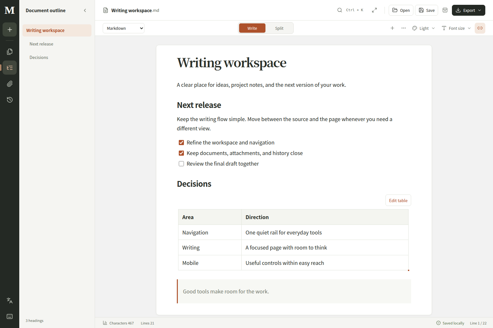
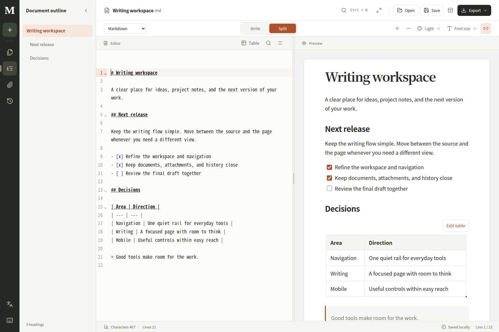

# Markword 網站改寫與驗收

日期：2026-11-12
專案：`/home/nvidia/ping/markword`

網站工作區已重新設計，並套用至既有的本機服務。這次以 Google Chrome 的 Modern Web Guidance 為依據，重整桌面與手機操作、修正實際重現的互動與安全問題，再完成建置及功能回歸。

## 新版工作區

- **桌面導覽**：深色垂直導覽列集中新建文件、文件清單、大綱、附件、版本記錄、語言與快捷鍵。文件／大綱側欄使用完整高度，搜尋與列表位置固定。
- **書寫與分割**：上方以「書寫／分割」切換頁面編輯及原始碼雙欄。格式、主題、字級和新增內容整合到共用工具列；HTML 單頁模式也能直接切換文件格式。
- **閱讀層次**：淺灰工作區、白色文件頁面與收斂的橘棕重點色，將文件內容放在視覺中心。預覽維持原有八種文件主題。
- **手機操作**：常用導覽移到底部，編輯器與預覽以分頁切換。工具列依容器寬度縮排，320px 至桌面寬度皆已檢查。
- **鍵盤與焦點**：手機分頁支援方向鍵、Home、End；專注模式直接將輸入焦點送入編輯器，離開後返回觸發按鈕。

這次結構改寫主要位於 [App.tsx](../frontend/src/App.tsx)、[ActivityRail.tsx](../frontend/src/components/ActivityRail.tsx) 與 [workspaceShell.css](../frontend/src/workspaceShell.css)。原本樣式表中的舊工作區排版已移除，文件主題與編輯元件仍由各自的樣式負責。

## 功能修正

| 問題 | 完成的修正 |
| --- | --- |
| 中文選字時 Enter 提前送出命令、改名或資料欄位 | 命令選單、文件重新命名及 HTML Data 面板加入 IME composition 判斷 |
| Export 選單按 Escape 同時關掉文件側欄 | Escape 先交給開啟的選單處理 |
| 手機大綱的展開狀態與畫面不一致 | 依手機／桌面實際狀態更新 aria-expanded |
| 從書寫模式進入專注模式後鍵盤焦點落在頁面 | 進入時聚焦編輯器，離開時還原視圖與觸發按鈕焦點 |
| 分割模式兩側首行高度不同 | 原始碼上邊距與文件畫布邊距連動；原有首行差距小於 4px 的測試通過 |
| 拖曳文字到對話框外可能意外關閉 | 按下與放開都在背景時才關閉 |
| 原生對話框的自製 Tab 循環與瀏覽器行為衝突 | 交由原生 showModal 管理背景 inert 與焦點，測試完整正反向順序 |
| 點擊匯出預覽後 Escape 失效 | 父頁在匯出預覽文件安裝鍵盤監聽器；組字中不關閉，腳本仍被 sandbox 禁止 |

## Modern Web Guidance

本次讀取的 skill 版本為 `2026_11_09-5bcc021b`。以下為實際採用的指引及實作：

| 指引 | 原文重點 | 實作 |
| --- | --- | --- |
| [CSS layout](https://github.com/GoogleChrome/modern-web-guidance/blob/main/skills/modern-web-guidance/guides/css/css-layout.md) | “Use `grid-template-areas` for complex page-level layouts” | 用 Grid 區域定義導覽列、側欄、標頭、工具列、工作區與狀態列 |
| [Responsive design](https://github.com/GoogleChrome/modern-web-guidance/blob/main/skills/modern-web-guidance/guides/css/responsive-design.md) | “Use `@container` queries to create component-driven responsive layouts” | 工具列依實際可用寬度調整；工作區採 100dvh 與手機安全區 |
| [Dialog](https://github.com/GoogleChrome/modern-web-guidance/blob/main/skills/modern-web-guidance/guides/ui-components/dialog.md) | “Require the press and the release outside” | 保留原生 dialog，修正背景點擊與拖曳關閉時機 |
| [Accessibility](https://github.com/GoogleChrome/modern-web-guidance/blob/main/skills/modern-web-guidance/guides/accessibility/accessibility.md) | “When applying `role="tab"` to an element, it must then behave like a tab” | 分頁鍵盤操作、焦點還原、ARIA 狀態與實際畫面一致 |
| [Dark mode](https://github.com/GoogleChrome/modern-web-guidance/blob/main/skills/modern-web-guidance/guides/visual-design/dark-mode.md) | “Apply the `color-scheme` property to the `html` element or the `:root` pseudo-class.” | 明確宣告工作區亮色與文件深色主題，讓原生控制項及捲軸跟隨所在區域 |
| [IME-safe enter-to-submit](https://github.com/GoogleChrome/modern-web-guidance/blob/main/skills/modern-web-guidance/guides/forms/ime-safe-enter-submit.md) | “The composition-active check applies to any custom `keydown` handler that acts on `Enter`” | 自訂 Enter／Escape 操作檢查 isComposing 與 keyCode 229 |

## 功能驗收

**284 個不同的瀏覽器案例有通過紀錄**：標準 UI 共 275 案，共用工作區與 Quick Capture 共 9 案。

| 檢查 | 結果 |
| --- | --- |
| 完整標準 UI 回歸 | 273 passed／274 案，5.9 分鐘；唯一失敗為修正前的 iframe Escape 案 |
| 修正後匯出預覽＋原生 dialog 回歸 | 8／8 passed，8.5 秒；涵蓋上述失敗案及新增的第 275 案 |
| 共用工作區與 Quick Capture | 9／9 passed，26.5 秒 |
| Python 後端完整測試 | 112 passed，33.78 秒 |
| ESLint、TypeScript | 通過 |
| 完整版正式建置 | 通過 |
| Pages 版正式建置 | 通過 |
| git diff --check | 通過 |
| 正式服務健康檢查與靜態資源 | HTTP 200，健康檢查 ok，新版工作區樣式正常載入 |
| 正式服務瀏覽器檢查 | 桌面、390px 手機與指令選單通過；0 page errors、0 工作區寫入請求 |

瀏覽器驗收使用 Chromium。版面檢查涵蓋 320、390、768、1024px 與桌面寬度，繁中／英文的匯出、編輯工具、主題與字級選單均在畫面範圍內。

已覆蓋的流程包括 Markdown 文字與區塊編輯、拖曳多選、復原重做、表格、公式、Mermaid、HTML 視覺／原始碼／JSON 資料／互動預覽、文件改名與複製、垃圾桶還原、附件、版本還原、跨瀏覽器衝突、離線與失敗恢復，以及 Markdown／HTML／ZIP／Word 匯入及 HTML／ZIP／PDF／Word 匯出。

測試記錄位於：

- `/tmp/markword-ui-final.log`
- `/tmp/markword-export-dialog-final.log`
- `/tmp/markword-shared-verified.log`
- `/tmp/markword-lint-final.log`
- `/tmp/markword-tsc-final.log`
- `/tmp/markword-build-final.log`
- `/tmp/markword-pages-final.log`

測試沿用現有服務使用的 SQLite 3.53.3 動態函式庫。這台機器的 SQLite 3.51.1 曾造成 WAL 連線卡住；詳細操作已補入[開發文件](development.md)。

## 安全檢查

詳見[安全檢查與修正報告](security-review-2026-11-12.md)。

- 已重現並修正 HTML／SVG 附件透過 API URL 及原始 MIME Blob URL 在工作區來源執行腳本的入口。
- 附件 API 改為下載回應，帶 sandbox CSP 與 nosniff；預覽中的一般附件改用下載 Blob。圖片與影音仍能正常顯示。
- 前端相依套件已清除 critical 與 high 公告節點；目前 npm audit 為 **0 critical／0 high／7 moderate／2 low**。
- Python 環境 71 個套件經 pip-audit 檢查，**0 個已知公告漏洞**。

目前 npm 的 9 個公告節點分屬兩條相依鏈：開發工具 typescript-eslint → minimatch，以及 Mermaid → KaTeX。修補條件與上游版本狀態記在安全報告中。

目前服務監聽 `0.0.0.0:27860`，工作區 API 沒有登入驗證。能連到此連接埠的裝置可讀寫共用工作區。若開放外網或不受信任的網路，入口需透過具驗證的反向代理並限制來源。

## 本機服務

既有使用者服務 `markword.service` 已重新啟動並載入新版，狀態為 `active/running`，服務埠仍為 `27860`。正式服務已完成唯讀瀏覽器確認。

Vite 建置仍有大 chunk 提醒，主 bundle 約 503 kB gzip；建置成功。這項體積影響首次下載成本，可在下一次效能工作中依實際載入耗時決定拆分位置。
